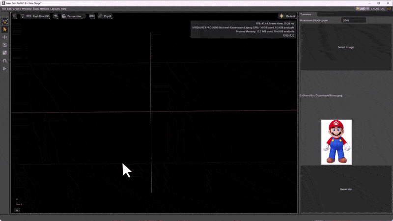

# Isaac Sim Extensions

A collection of custom extensions for NVIDIA Isaac Sim.

## Dominoes Image Generator

Convert an image into a colorful domino block display in Isaac Sim.



### Features

- Generates colored domino blocks from an image.
- Supports PNG, JPG, JPEG, BMP, TIF, TIFF, and WEBP images.
- Limits the generated block count and resizes large images to fit.
- Adds collision and rigid-body physics to the blocks.
- Disables generation while the simulation is playing.

### Install

Add this repository folder to the Kit extension search paths:

```text
C:\dev\isaacsim_extensions
```

Alternatively, append this argument to the Isaac Sim launch command:

```text
--ext-folder "C:\dev\isaacsim_extensions"
```

Then enable `cml_dominoes` in Extension Manager.

### Use

1. Open the **Tools > CML > Dominoes** window.
2. Set the maximum block count.
3. Select an image.
4. Click **Generate** while the simulation is stopped.

A USD stage must be open before generating.

## LinkedIn

[LinkedIn](https://www.linkedin.com/in/idkfa/)
