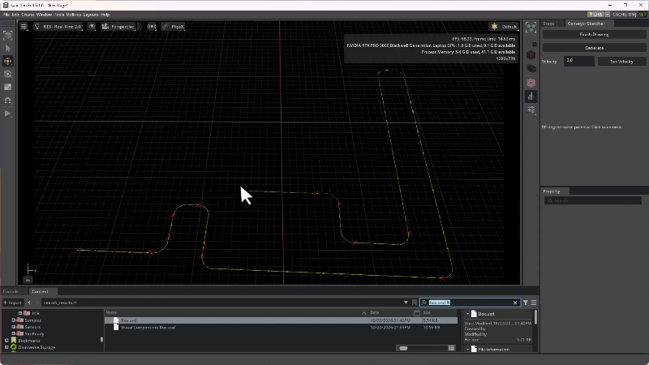
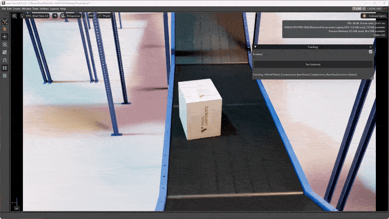

# Isaac Sim Extensions

A collection of custom extensions for NVIDIA Isaac Sim.

## Install

Add this repository folder to the Kit extension search paths:

```text
C:\dev\isaacsim_extensions
```

Alternatively, append this argument to the Isaac Sim launch command:

```text
--ext-folder "C:\dev\isaacsim_extensions"
```

Open **Window > Extensions** and enable the extensions you want to use:

- `cml_conveyor_sketcher`
- `cml_dominoes`
- `cml_tracking`

## Conveyor Sketcher

Draw conveyor routes in the viewport and generate conveyors from Conveyor Track Builder assets.



### Features

- Previews a route as you place points on the ground plane.
- Generates straight conveyor sections and 90- or 180-degree curves.
- Splits long straight runs into full-length and partial conveyor sections.
- Sets velocity on generated conveyors or selected conveyor graphs.

### Use

1. Open a USD stage and open **Tools > CML > Conveyor Sketcher**.
2. Set the conveyor velocity.
3. Click **Start Drawing**, then click the ground plane to place route points.
4. Click **Finish Drawing**, then click **Generate**.

Each drawing creates a new group in the Stage. Curve generation requires a Z-up stage.

## Dominoes Image Generator

Convert an image into a colorful domino block display in Isaac Sim.


### Features

- Generates colored domino blocks from an image.
- Supports PNG, JPG, JPEG, BMP, TIF, TIFF, and WEBP images.
- Limits the generated block count and resizes large images to fit.
- Adds collision and rigid-body physics to the blocks.
- Disables generation while the simulation is playing.

### Use

1. Open **Tools > CML > Dominoes**.
2. Set the maximum block count.
3. Select an image.
4. Click **Generate** while the simulation is stopped.

A USD stage must be open before generating.

## Tracking

Follow a moving object in the viewport with a level camera that tracks its path without rolling with the object.



### Features

- Follows the selected object's live pose, resolving a unique mesh or rigid body in a group when possible.
- Preserves the camera's initial side angle while following the object's horizontal travel direction.
- Keeps the camera level with the stage up axis instead of rolling with the object.

### Use

1. Open a USD stage and select the moving object in the Stage.
2. Open **Tools > CML > Tracking** and click **Set Selected** to lock the target and focus the camera on it.
3. Enable **Enabled** to make the camera follow the locked target; uncheck it to pause following. Re-enabling resumes the same target and camera offset/angle.
4. Select another object and click **Set Selected** again to change the locked target.

For a grouped object, the extension uses its rigid body or unique mesh when available. If the selection contains multiple rigid bodies, select one object directly.

[LinkedIn](https://www.linkedin.com/in/idkfa/)
